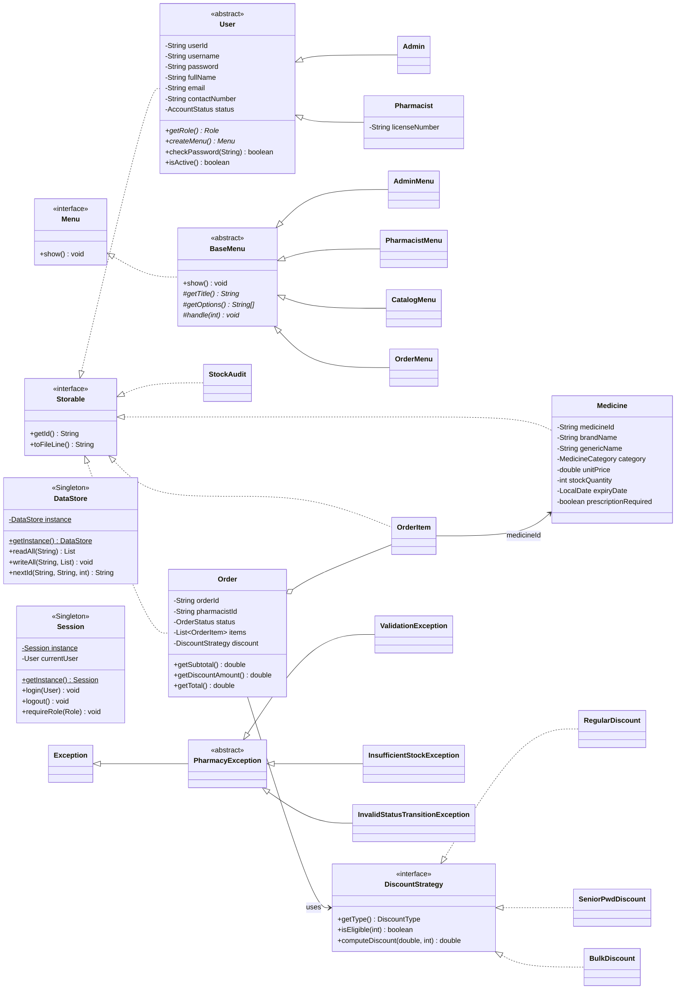

# Architecture

How the Pharmacy Management System is put together. This is the **contract** between the three members: the class names, packages, and method signatures in §6 are what the others code against. Change them only through the protocol in [CONVENTIONS.md §5](CONVENTIONS.md#5-changing-common-or-a-cross-member-contract).

> Status: **designed, not yet implemented.** No Java code exists yet. When code and this doc disagree, the code wins — fix this doc in the same commit.

---

## 1. Runtime at a glance

- Plain **Java 17+** console program, no frameworks, no external libraries.
- One entry point: `pharmacy.Main`.
- All data lives in pipe-delimited text files under `data/` (created on first run, never committed). Format: [DATA.md](DATA.md).
- One user at a time. The logged-in user is held by the `Session` singleton.

## 2. Folder → package map

Each member's code lives in **their own folder**, but all folders compile together into one program (they share the `pharmacy` package root).

```
common/src/pharmacy/                  owner: Heather (shared foundation)
├── Main.java
└── common/
    ├── model/       Storable, User, Admin, Pharmacist, Role, AccountStatus
    ├── data/        DataStore (Singleton), DataFiles
    ├── session/     Session (Singleton)
    ├── exception/   PharmacyException + 6 shared subclasses
    ├── util/        ConsoleInput, InputRule, InputValidator, Format
    └── ui/          Menu, BaseMenu, AdminMenu, PharmacistMenu

heather/src/pharmacy/auth/            owner: Heather
├── UserRepository, AuthService, UserService
└── ui/          AuthMenu, ProfileMenu, UserManagementMenu

karlo/src/pharmacy/inventory/         owner: Karlo
├── MedicineRepository, StockAuditRepository, InventoryService, MedicineFilter
├── model/       Medicine, MedicineCategory, MedicineStatus, StockAudit
├── exception/   InsufficientStockException
└── ui/          MedicineBrowserMenu, CatalogMenu, StockAuditMenu

cameron/src/pharmacy/orders/          owner: Cameron
├── OrderRepository, VoidRecordRepository, OrderService, AnalyticsService
├── model/       Order, OrderItem, OrderStatus, VoidRecord
├── discount/    DiscountStrategy, DiscountType, RegularDiscount, SeniorPwdDiscount, BulkDiscount
├── exception/   InvalidStatusTransitionException
└── ui/          OrderMenu, OrderAdminMenu, AnalyticsMenu
```

The folder path below `src/` **must** match the `package` line (e.g. `karlo/src/pharmacy/inventory/model/Medicine.java` → `package pharmacy.inventory.model;`).

## 3. Layers

Every feature follows the same three layers. Never skip a layer.

```
 UI (menus)  ──►  Service  ──►  Repository  ──►  DataStore  ──►  data/*.txt
 *Menu            *Service       *Repository      (Singleton)
 reads input      business rules  object ⇄ line    raw file I/O
 prints output    role checks     find/save/delete
 catches errors   throws errors
```

| Layer | Does | Must not |
|---|---|---|
| **UI** (`*.ui.*Menu`) | Show options, read input with `ConsoleInput`, call one service method, print the result. Errors are caught by `BaseMenu`. | Contain business rules, touch files, compute totals. |
| **Service** (`*Service`) | Re-validate input (`InputValidator`), check role (`Session.requireRole`), enforce business rules, call repositories. Throws `PharmacyException` subclasses. | Read from `System.in`, print to `System.out`, call `System.exit`. |
| **Repository** (`*Repository`) | Convert between objects and file lines; find, save, delete. **Stateless:** reads the file on every call, writes the whole file after every change. | Contain business rules. |
| **DataStore** | The only class that opens files. | Know about any model class except `Storable` (and the seeded `Admin`). |

Why validate twice (UI and service)? `ConsoleInput` re-prompts so the user can fix a typo without losing their place; the service is the **authority** and rejects anything invalid regardless of which menu called it.

## 4. Class diagram



(Only the main classes are shown. The full list is in §2.)

## 5. Design patterns (GoF)

### 5.1 Singleton — `DataStore` and `Session`

Both use the same shape (eager, thread-safe enough for a single-threaded console app):

```java
public final class Session {
    private static final Session INSTANCE = new Session();
    private User currentUser;

    private Session() { }                       // nobody else can construct it

    public static Session getInstance() { return INSTANCE; }
}
```

| Singleton | Why only one |
|---|---|
| `DataStore` | One place that owns the `data/` folder and file I/O, so two classes never write the same file in different formats. |
| `Session` | There is exactly one logged-in user at a time; every service asks it "who is acting?" |

### 5.2 Strategy — discounts

`Order` holds a `DiscountStrategy` and asks it for the discount. It never checks the discount type itself.

```java
public interface DiscountStrategy {
    DiscountType getType();
    String getLabel();                                   // e.g. "Senior Citizen / PWD (20%)"
    boolean isEligible(int totalUnits);
    double computeDiscount(double subtotal, int totalUnits);
}
```

| Strategy | Rule | Constant(s) |
|---|---|---|
| `RegularDiscount` | Always eligible, discount = 0 | — |
| `SeniorPwdDiscount` | Always eligible; the **service** requires a Senior/PWD ID number before choosing it. Discount = 20% of subtotal | `RATE = 0.20` |
| `BulkDiscount` | Eligible only when the order has **50 or more total units**. Discount = 10% of subtotal | `RATE = 0.10`, `MIN_UNITS = 50` |

`DiscountType` is an enum (`REGULAR`, `SENIOR_PWD`, `BULK`) with `DiscountStrategy toStrategy()`, used when loading an order from file and when the pharmacist picks a discount from a menu.

## 6. Cross-member contracts

These are the only classes/methods one member may call in another member's folder. Everything else is private to its owner. All methods listed `throws` checked exceptions from §7.

### 6.1 Provided by `common/` (Heather) — used by everyone

```java
// pharmacy.common.model
public interface Storable { String getId(); String toFileLine(); }
public enum Role { ADMIN, PHARMACIST }
public enum AccountStatus { ACTIVE, DEACTIVATED }
public abstract class User implements Storable {
    public abstract Role getRole();
    public abstract Menu createMenu();               // Admin → AdminMenu, Pharmacist → PharmacistMenu
    public boolean checkPassword(String attempt);
    public boolean isActive();
    // getters for userId, username, fullName, email, contactNumber, status (+ setters except id/role)
}
public class Admin extends User { }
public class Pharmacist extends User { public String getLicenseNumber(); public void setLicenseNumber(String); }

// pharmacy.common.data
public final class DataStore {
    public static DataStore getInstance();
    public List<String[]> readAll(String fileName) throws DataAccessException;      // skips blank lines; split("\\|", -1)
    public void writeAll(String fileName, List<? extends Storable> records) throws DataAccessException;
    public void append(String fileName, Storable record) throws DataAccessException;
    public String nextId(String fileName, String prefix, int digits) throws DataAccessException; // "MED-", 4 → "MED-0007"
    public void seedDefaults() throws DataAccessException;                          // creates data/ and the default admin
}
public final class DataFiles {   // file-name constants — never hard-code a file name elsewhere
    USERS = "users.txt"; MEDICINES = "medicines.txt"; STOCK_AUDITS = "stock_audits.txt";
    ORDERS = "orders.txt"; ORDER_ITEMS = "order_items.txt"; VOID_LOG = "void_log.txt";
}

// pharmacy.common.session
public final class Session {
    public static Session getInstance();
    public void login(User user);
    public void logout();
    public boolean isLoggedIn();
    public User getCurrentUser();                                  // null when logged out
    public User requireUser() throws AuthenticationException;      // throws when logged out
    public void requireRole(Role role) throws AuthenticationException, AccessDeniedException;
}

// pharmacy.common.util
@FunctionalInterface public interface InputRule { void check(String value) throws ValidationException; }
public final class ConsoleInput {              // one shared Scanner; every method loops until valid
    public static String readRequired(String prompt);                     // non-blank, no '|'
    public static String readOptional(String prompt);                     // blank → "" (= keep current value)
    public static String readValidated(String prompt, InputRule rule);    // e.g. InputValidator::requireEmail
    public static int readInt(String prompt, int min, int max);
    public static double readDouble(String prompt, double min, double max);
    public static LocalDate readDate(String prompt);                      // yyyy-MM-dd, real calendar date
    public static boolean readYesNo(String prompt);                       // y/yes/n/no, case-insensitive
    public static void pause();                                           // "Press Enter to continue..."
}
public final class InputValidator { /* static require*(...) methods — full list in VALIDATION.md */ }
public final class Format {
    public static final DateTimeFormatter DATE;        // yyyy-MM-dd
    public static final DateTimeFormatter DATE_TIME;   // yyyy-MM-dd HH:mm:ss
    public static String peso(double amount);          // "PHP 1,234.50"
    public static double round2(double amount);
}

// pharmacy.common.ui
public interface Menu { void show(); }
public abstract class BaseMenu implements Menu {
    protected abstract String getTitle();
    protected abstract String[] getOptions();                       // printed as 1..n; 0 is always Back
    protected abstract void handle(int choice) throws PharmacyException;
    protected String getExitLabel() { return "Back"; }              // AdminMenu/PharmacistMenu override → "Logout"
    public final void show();                                        // loop + catch PharmacyException (see §7)
}
```

### 6.2 Provided by `heather/` — used by Cameron and `common/`

```java
// pharmacy.auth
public class UserRepository {
    public List<User> findAll() throws DataAccessException;
    public User findById(String userId) throws NotFoundException, DataAccessException;
}
// pharmacy.auth.ui
public class AuthMenu {                        // called by Main's welcome screen
    public void login();                       // on success: Session.getInstance().login(user)
    public void register();
}
public class ProfileMenu extends BaseMenu { }          // used by AdminMenu and PharmacistMenu
public class UserManagementMenu extends BaseMenu { }   // used by AdminMenu
```

### 6.3 Provided by `karlo/` — used by Cameron and `common/`

```java
// pharmacy.inventory
public class InventoryService {
    public Medicine findSellable(String medicineId)
        throws NotFoundException, ValidationException, DataAccessException;          // ACTIVE and not expired
    public void reserveStock(String medicineId, int quantity)
        throws NotFoundException, InsufficientStockException, ValidationException, DataAccessException;
    public void restoreStock(String medicineId, int quantity)
        throws NotFoundException, ValidationException, DataAccessException;
}
public class MedicineRepository {
    public Medicine findById(String medicineId) throws NotFoundException, DataAccessException;
}
public class StockAuditRepository {
    public List<StockAudit> findAll() throws DataAccessException;                   // for shrinkage analytics
}
// pharmacy.inventory.model — Medicine getters: getId, getBrandName, getGenericName, getCategory,
//   getUnitPrice, getStockQuantity, getExpiryDate, isPrescriptionRequired, isExpired(LocalDate today)
// StockAudit getters: getMedicineId, getSystemQuantity, getCountedQuantity, getDifference, getAuditDate
// pharmacy.inventory.ui
public class MedicineBrowserMenu extends BaseMenu { }   // used by PharmacistMenu
public class CatalogMenu extends BaseMenu { }           // used by AdminMenu
public class StockAuditMenu extends BaseMenu { }        // used by AdminMenu
```

### 6.4 Provided by `cameron/` — used by Heather, Karlo and `common/`

```java
// pharmacy.orders
public class OrderService {
    public boolean hasOrdersForMedicine(String medicineId) throws DataAccessException;  // Karlo: delete vs discontinue
    public boolean hasOrdersForPharmacist(String userId) throws DataAccessException;    // Heather: delete vs deactivate
}
// pharmacy.orders.ui
public class OrderMenu extends BaseMenu { }        // used by PharmacistMenu
public class OrderAdminMenu extends BaseMenu { }   // used by AdminMenu
public class AnalyticsMenu extends BaseMenu { }    // used by AdminMenu
```

## 7. Exception handling

All custom exceptions are **checked** (`PharmacyException extends Exception`) so the compiler forces every caller to handle them.

```
Exception
└── PharmacyException (abstract)               common   pharmacy.common.exception
    ├── ValidationException                    common   bad input / broken business rule
    ├── AuthenticationException                common   wrong credentials, deactivated account, not logged in
    ├── AccessDeniedException                  common   logged in but wrong role / not your record
    ├── NotFoundException                      common   ID or username does not exist
    ├── DuplicateRecordException               common   username / email / license / brand+strength already used
    ├── DataAccessException                    common   wraps IOException from DataStore
    ├── InsufficientStockException             karlo    pharmacy.inventory.exception
    └── InvalidStatusTransitionException       cameron  pharmacy.orders.exception
```

Where each one is handled:

| Place | Catches | Does |
|---|---|---|
| `ConsoleInput` | `NumberFormatException`, `DateTimeParseException`, `ValidationException` from an `InputRule` | Prints the message and asks again. Never lets a bad keystroke crash the program. |
| `BaseMenu.show()` | `PharmacyException` from `handle(...)` | Prints `Error: <message>` and returns to the same menu. |
| `Main` | Any `RuntimeException` that escaped | Prints `Unexpected error: <message>`, logs out, returns to the welcome screen. (This is a safety net for bugs — fix the bug, don't rely on it.) |
| `DataStore` | `IOException` | Re-throws as `DataAccessException` with a readable message (`"Could not save medicines.txt"`). |
| Services | Nothing (they throw) | Exception: when a multi-step write fails half-way, undo the first step before re-throwing (see §9.3). |

Exception messages are **user-facing**: write them as a sentence the pharmacist can act on (`"Only 4 units of Biogesic 500mg left."`), never a stack trace or class name.

## 8. Program flow

```
Main.main
 └─ DataStore.getInstance().seedDefaults()          create data/ + default admin if missing
 └─ loop: Welcome screen
      1 Login     → AuthMenu.login()      → Session.login(user)
                    → Session.getCurrentUser().createMenu().show()   ◄── polymorphism
                    → (user chose 0 Logout) Session.logout()
      2 Register  → AuthMenu.register()   → back to welcome (user must log in)
      0 Exit
```

### Menu tree

```
Welcome ─ 1 Login · 2 Register · 0 Exit

PharmacistMenu (common)                 AdminMenu (common)
 1 Medicines        → MedicineBrowserMenu (karlo)     1 Medicine catalog      → CatalogMenu (karlo)
 2 Dispensing orders→ OrderMenu (cameron)             2 Stock & inventory     → StockAuditMenu (karlo)
 3 My profile       → ProfileMenu (heather)           3 Manage users          → UserManagementMenu (heather)
 0 Logout                                              4 Orders & prescriptions→ OrderAdminMenu (cameron)
                                                       5 Sales & analytics     → AnalyticsMenu (cameron)
                                                       6 My profile            → ProfileMenu (heather)
                                                       0 Logout
```

The options inside each sub-menu are listed per feature in [FEATURES.md](FEATURES.md).

## 9. Orders, stock, and status

### 9.1 Status machine

Owned by `OrderStatus` (Cameron): `boolean canTransitionTo(OrderStatus next)`. Every status change goes through it; an illegal change throws `InvalidStatusTransitionException`.

```
            put on hold            resume
 PENDING ───────────────► ON_HOLD ────────► PENDING
   │  │                     │
   │  └─ cancel ─────────►  CANCELLED  ◄── cancel ─┘     (terminal)
   │
   └─ complete ──► COMPLETED ── void (Admin only, memo required) ──► VOIDED  (terminal)
```

| From → To | Who |
|---|---|
| PENDING → ON_HOLD, ON_HOLD → PENDING | Owning pharmacist, or Admin |
| PENDING → COMPLETED | Owning pharmacist, or Admin |
| PENDING/ON_HOLD → CANCELLED | Owning pharmacist, or Admin |
| COMPLETED → VOIDED | Admin only, through **Void** (needs a reason memo) |
| Anything from CANCELLED or VOIDED | Nobody — terminal |

Only PENDING and ON_HOLD orders can be edited (items, quantities, discount, notes).

### 9.2 Stock movement

Stock is **reserved** (subtracted) as soon as an item belongs to a saved order, so two orders can never sell the same last box.

| Event | Stock effect (via Karlo's `InventoryService`) |
|---|---|
| Building a **new** order (O1 cart, in memory) | none — each item is only *checked* against `findSellable(id).getStockQuantity()` |
| Saving the new order (pending or completed) | `reserveStock` for every item. If one fails, `restoreStock` the ones already reserved, then re-throw. **Discard** touches nothing. |
| Add item / increase quantity on a saved order | `reserveStock(id, addedQty)` |
| Remove item / decrease quantity | `restoreStock(id, removedQty)` |
| Complete | none (already reserved) — but re-check every item is not expired first |
| Cancel | `restoreStock` for every item |
| Void | `restoreStock` for every item + write a `void_log` row |

### 9.3 Writing safely across two files

Some actions change two files (stock in `medicines.txt`, order in `orders.txt`). Order of operations:

1. Reserve/restore stock.
2. Save the order.
3. If step 2 throws `DataAccessException`, undo step 1 (`restoreStock`/`reserveStock` the same quantity), then re-throw.

### 9.4 Money

`subtotal = Σ (quantity × unitPriceAtSale)` → `discount = strategy.computeDiscount(subtotal, totalUnits)` → `total = subtotal − discount`. Every value goes through `Format.round2`. `unitPriceAtSale` is copied from the medicine when the item is added, so later price changes never alter an existing order.

## 10. Where each OOP pillar is demonstrated

Every member must be able to point to all four in **their own** code during the defense.

| Pillar | common / Heather | Karlo | Cameron |
|---|---|---|---|
| **Encapsulation** | `User` private fields, no `setUserId`/`setRole`; `Session.currentUser` private | `Medicine` private fields; `setStockQuantity` rejects negatives | `Order.items` private, exposed as an unmodifiable list; totals computed, never set |
| **Abstraction** | `User`, `BaseMenu` (abstract), `Menu`, `Storable`, `InputRule` (interfaces) | `MedicineFilter` hides search rules behind one `matches(Medicine)` call | `DiscountStrategy` interface |
| **Inheritance** | `Admin`/`Pharmacist extends User`; exceptions `extend PharmacyException`; `ProfileMenu`, `UserManagementMenu extend BaseMenu` | `CatalogMenu`, `StockAuditMenu`, `MedicineBrowserMenu extend BaseMenu`; `InsufficientStockException` | `OrderMenu` etc. `extend BaseMenu`; `InvalidStatusTransitionException` |
| **Polymorphism** | `user.createMenu()`; `toFileLine()` overridden by `Admin`/`Pharmacist` | `handle(int)` overrides; `Medicine.toFileLine()` | `strategy.computeDiscount(...)` resolved at runtime; `handle(int)` overrides |
