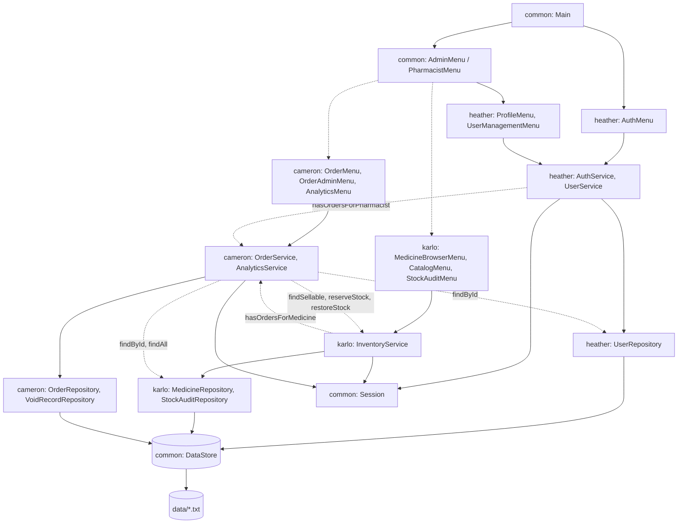

# Blueprint — every file in the app

The complete file map of the finished program: **every Java file, where it goes, what it does, who owns it, and in which milestone it is built.** Create files exactly at these paths. If you need a file that is not listed here, add it to this page in the same PR.

> Status: planned. No Java files exist yet. Signatures are in [ARCHITECTURE §6](ARCHITECTURE.md#6-cross-member-contracts); behaviour is in [FEATURES](FEATURES.md); rules are in [VALIDATION](VALIDATION.md).

**Totals:** 62 Java files: `common/` 25 · `heather/` 6 · `karlo/` 13 · `cameron/` 18.
**Milestones:** M0a/M0b/M0c = skeleton · M1 = features (see [README → Build order](../README.md#build-order)).

---

## 1. Whole repository

```
pharmacy-management-system/
├── README.md                     overview, how to run, build order
├── AGENTS.md                     rules for AI agents (read first)
├── CLAUDE.md                     "@AGENTS.md" — makes Claude Code load AGENTS.md
├── PROJECT-BRIEF.md              why the project exists, requirements, scope
├── .gitignore                    ignores out/, data/, *.class, IDE folders
├── .github/
│   └── pull_request_template.md  pre-filled PR description
│
├── docs/                         shared reference (everyone)
│   ├── BLUEPRINT.md              ← this file
│   ├── ARCHITECTURE.md           layers, diagram, patterns, cross-member contracts
│   ├── DATA.md                   data files, columns, formats, enums, constants
│   ├── FEATURES.md               every feature: owner, menu path, rules
│   ├── VALIDATION.md             every validation rule + hostile-input checklist
│   ├── DECISIONS.md              ADRs
│   ├── CONVENTIONS.md            code style, OOP rules, workflow
│   ├── GIT-GUIDE.md              exact git / GitHub commands
│   ├── GOTCHAS.md                shared Java pitfalls
│   └── SESSION_LOG.md            changes that affect everyone
│
├── common/                       shared foundation — owner: Heather   (§2)
├── heather/                      accounts           — owner: Heather   (§3)
├── karlo/                        medicines & stock  — owner: Karlo     (§4)
├── cameron/                      orders & analytics — owner: Cameron   (§5)
│     each member folder also has:
│     ├── AGENTS.md / CLAUDE.md   agent rules for that member
│     └── docs/
│         ├── CONTEXT.md          checklist of classes + definition of done
│         ├── PROMPTS.md          copy-paste prompts + git commands per step
│         ├── GOTCHAS.md          traps in that area
│         └── SESSION_LOG.md      that member's work log
│
├── data/                         created at runtime — NOT committed       (§6)
└── out/                          compiled .class files — NOT committed
```

## 2. `common/` — shared foundation (Heather)

```
common/src/pharmacy/
├── Main.java                         M0a  entry point: seed data, welcome loop, login → role menu → logout
└── common/
    ├── model/
    │   ├── Storable.java             M0a  interface: getId(), toFileLine() — every saved record
    │   ├── Role.java                 M0a  enum ADMIN, PHARMACIST
    │   ├── AccountStatus.java        M0a  enum ACTIVE, DEACTIVATED
    │   ├── User.java                 M0a  abstract base user: private fields, checkPassword, abstract getRole/createMenu
    │   ├── Admin.java                M0a  extends User → AdminMenu; empty license column
    │   └── Pharmacist.java           M0a  extends User + licenseNumber → PharmacistMenu
    ├── data/
    │   ├── DataStore.java            M0a  SINGLETON: only class that reads/writes data/*.txt; nextId; seedDefaults
    │   └── DataFiles.java            M0a  file-name constants (USERS, MEDICINES, ORDERS…)
    ├── session/
    │   └── Session.java              M0a  SINGLETON: current user, login/logout, requireUser, requireRole
    ├── exception/
    │   ├── PharmacyException.java    M0a  abstract checked base of all custom exceptions
    │   ├── ValidationException.java  M0a  bad input / broken business rule
    │   ├── AuthenticationException.java  M0a  wrong login, deactivated, not logged in
    │   ├── AccessDeniedException.java    M0a  wrong role / not your record
    │   ├── NotFoundException.java    M0a  unknown ID
    │   ├── DuplicateRecordException.java M0a  username/email/license/medicine already exists
    │   └── DataAccessException.java  M0a  wraps IOException
    ├── util/
    │   ├── ConsoleInput.java         M0a  the ONE Scanner; read* methods re-prompt until valid
    │   ├── InputRule.java            M0a  functional interface used by ConsoleInput.readValidated
    │   ├── InputValidator.java       M0a  static require*() rules from VALIDATION §2
    │   └── Format.java               M0a  DATE/DATE_TIME formatters, peso(), round2()
    └── ui/
        ├── Menu.java                 M0a  interface: show()
        ├── BaseMenu.java             M0a  abstract menu loop; catches PharmacyException
        ├── AdminMenu.java            M0a→M0c  admin home; opens Karlo/Cameron/Heather menus
        └── PharmacistMenu.java       M0a→M0c  pharmacist home; opens medicines/orders/profile
```

## 3. `heather/` — accounts (Heather)

```
heather/src/pharmacy/auth/
├── UserRepository.java               M1   users.txt ⇄ Admin/Pharmacist objects; find/save/delete; uniqueness checks
├── AuthService.java                  M1   register(), login() — rules A1–A7
├── UserService.java                  M1   own profile + admin user management — rules A8–A13
└── ui/
    ├── AuthMenu.java                 M0a  login() and register() screens (called by Main)
    ├── ProfileMenu.java              M0a  view / update details / change password
    └── UserManagementMenu.java       M0b  admin: list, search, view, create, update, (de)activate, delete
```

## 4. `karlo/` — medicines & inventory (Karlo)

```
karlo/src/pharmacy/inventory/
├── MedicineRepository.java           M1   medicines.txt ⇄ Medicine; find/save/delete
├── StockAuditRepository.java         M1   stock_audits.txt (append-only)
├── InventoryService.java             M1   catalog CRUD, reports, audits, findSellable/reserveStock/restoreStock
├── MedicineFilter.java               M1   search criteria + matches(Medicine, today)
├── model/
│   ├── Medicine.java                 M1   medicine record; isExpired, isNearExpiry, isLowStock, isSellable
│   ├── MedicineCategory.java         M1   enum + getLabel()
│   ├── MedicineStatus.java           M1   enum ACTIVE, DISCONTINUED
│   └── StockAudit.java               M1   one physical-count record (system vs counted)
├── exception/
│   └── InsufficientStockException.java  M1  quantity > stock
└── ui/
    ├── MedicineBrowserMenu.java      M0b  pharmacist: browse, search & filter, details
    ├── CatalogMenu.java              M0b  admin: catalog CRUD
    ├── StockAuditMenu.java           M0b  admin: low stock, expiry, physical count, lot/expiry, history
    └── MedicineTable.java            M1   prints medicine lists/details the same way everywhere (helper, not a menu)
```

## 5. `cameron/` — orders, discounts, analytics (Cameron)

```
cameron/src/pharmacy/orders/
├── OrderRepository.java              M1   orders.txt + order_items.txt ⇄ Order; save writes both
├── VoidRecordRepository.java         M1   void_log.txt (append-only)
├── OrderService.java                 M1   cart check, place/update/complete/cancel, admin status/void/search/Rx audit
├── AnalyticsService.java             M1   builds a SalesReport for a date range
├── model/
│   ├── Order.java                    M1   order header + items + DiscountStrategy; computed totals
│   ├── OrderItem.java                M1   medicineId, quantity, unitPriceAtSale, getLineTotal
│   ├── OrderStatus.java              M1   enum + canTransitionTo / isEditable / isTerminal
│   ├── VoidRecord.java               M1   one void memo
│   └── SalesReport.java              M1   result of AnalyticsService (revenue, counts, top 5, shrinkage)
├── discount/
│   ├── DiscountStrategy.java         M1   STRATEGY interface
│   ├── DiscountType.java             M1   enum REGULAR/SENIOR_PWD/BULK + toStrategy()
│   ├── RegularDiscount.java          M1   0%
│   ├── SeniorPwdDiscount.java        M1   20%
│   └── BulkDiscount.java             M1   10% at 50+ units
├── exception/
│   └── InvalidStatusTransitionException.java  M1  illegal status change
└── ui/
    ├── OrderMenu.java                M0b  pharmacist: new, my orders, update, complete, cancel
    ├── OrderAdminMenu.java           M0b  admin: all, search, view, status, void, Rx audit
    └── AnalyticsMenu.java            M0b  admin: daily, monthly, yearly, custom range
```

## 6. Runtime-only folders (never committed)

```
data/                     created by DataStore.seedDefaults() — format in DATA.md
├── users.txt             Heather
├── medicines.txt         Karlo
├── stock_audits.txt      Karlo
├── orders.txt            Cameron
├── order_items.txt       Cameron
└── void_log.txt          Cameron
out/                      javac -d out ... puts .class files here
```

## 7. Who calls whom

Arrows mean "calls / uses". Dashed arrows cross into another member's folder and **must** use only the contracts in [ARCHITECTURE §6](ARCHITECTURE.md#6-cross-member-contracts).



Every UI class also uses `ConsoleInput`, every service uses `InputValidator`, and everything uses the shared exceptions. Those lines are left out to keep the diagram readable.

## 8. Two traces through the files

These show how one user action travels through the files. Use them to explain the architecture in the defense.

**Pharmacist logs in**
1. `Main` → welcome option 1 → `AuthMenu.login()`
2. `AuthMenu` reads the username and password with `ConsoleInput`, then calls `AuthService.login(...)`
3. `AuthService` → `UserRepository.findByLogin(...)` → `DataStore.readAll("users.txt")` → creates a `Pharmacist`
4. `AuthService` checks the password and status (or throws `AuthenticationException`) → `AuthMenu` calls `Session.getInstance().login(user)`
5. `Main` → `user.createMenu()` returns a `PharmacistMenu` (**polymorphism**) → `.show()`

**Pharmacist saves a new order with a Senior/PWD discount**
1. `PharmacistMenu` → `OrderMenu.handle(1)`, the new-order screen
2. For each item: `OrderService.checkItem(...)` → `InventoryService.findSellable(...)` (Karlo)
3. Choosing the discount: `DiscountType.SENIOR_PWD.toStrategy()` gives a `SeniorPwdDiscount` (**Strategy**), stored in the `Order`
4. `OrderService.placeOrder(order, false)` validates O1–O7 → `InventoryService.reserveStock(...)` for every item (rolling back on failure) → `OrderRepository.save(order)` → `DataStore.writeAll` on `orders.txt` and `order_items.txt`
5. `OrderMenu` prints `order.getTotal()`, which calls `discount.computeDiscount(...)` (**polymorphism**). Any `PharmacyException` is caught by `BaseMenu` (**exception handling**).
